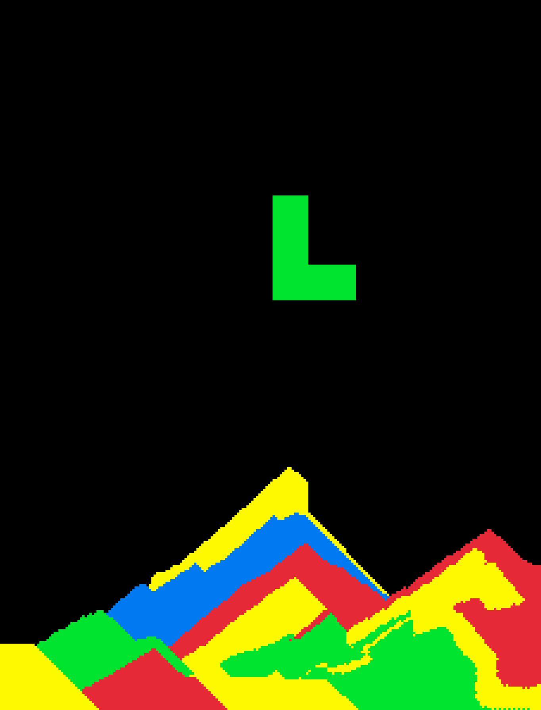
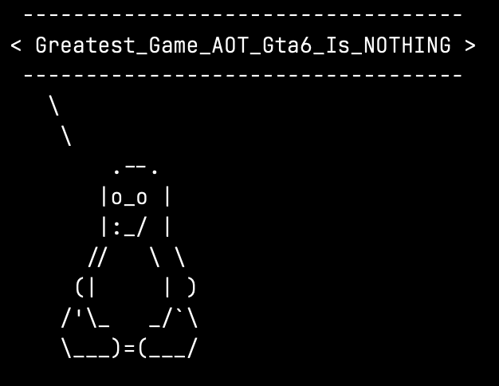
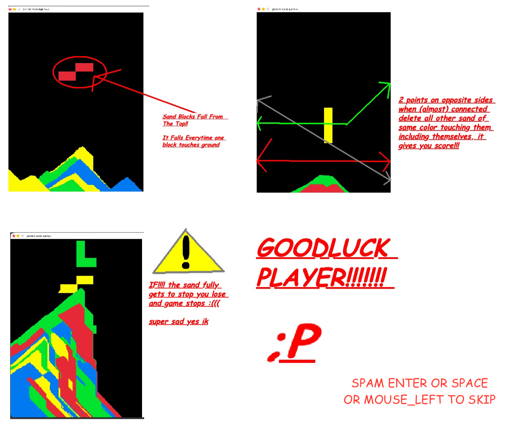

> NOTE: LLM Usage was there, it was used for fixing mainly WASM errors and adding slanted line detection, Wayy More Than Majority Of The Code Was Written By ***ME***  

# Generic_Sand_Game.c   

> gsgc.c, It Is An OpenSource & **totally generic** sand game which is not **totally** not inspired from the hit 1985 russian game which has falling blocks but instead of falling blocks now its sand which has cartoon gravity (it does not behave like sand unless it hits the ground), you can play it by   
> [(Clicking ME!)](https://gsgc.jassi.dev/)

### Why should i play this?

 because:

1. It's free :)
2. Its cool
3. Its Made From Scratch
4. Its Made With C!!!!
4. Why not?
5. Its Super Duper Cool
6. please (,,>﹏<,,)👉👈

### How to use On Local Machine
   > Download The Latest Build From Releases!!
       also Tux Has Somethings To Say:  
   > 

## Some Guide Stuff

| guide part 1 |  |
| ------------- | ------------- |
| guide part 2 |  |
| ------------- | ------------- |
| guide part 3 |  |
| ------------- | ------------- |
| guide full |  |

> Logo Was Made Using Tuxsay *(:[which is on this site](https://ochatc.jassi.dev/))*
> thats it, jassi out :)
